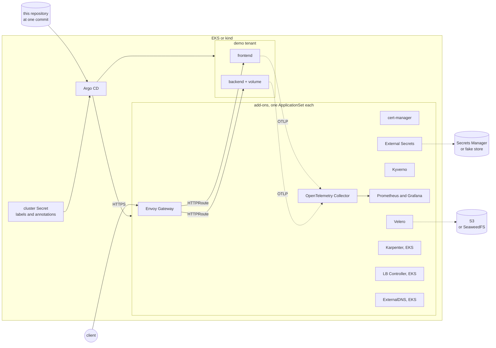

# aws-eks-reference-platform

[](https://github.com/heyvaldemar/aws-eks-reference-platform/actions/workflows/kind-e2e.yml)
[](https://github.com/heyvaldemar/aws-eks-reference-platform/actions/workflows/verification.yml)
[](https://scorecard.dev/viewer/?uri=github.com/heyvaldemar/aws-eks-reference-platform)
[](https://www.bestpractices.dev/projects/15462)

A reference Kubernetes platform for Amazon EKS: Terraform for the cluster, Argo CD for everything on it, and a test suite that proves what the platform does instead of describing it. It is a reference architecture, not a product, and it does not run in production anywhere.

The whole platform is **tested daily on kind**, on a GitHub runner, at no cloud cost. The EKS path is written and tested against a mocked AWS provider; it has not been applied to a real account yet, and this README will say so until it has.

## What is proven, and how

Every line below is a check that fails the build when the claim stops being true, and every check is shown the violation it exists for, on purpose, so a check that cannot fail is caught too.

| Claim | Proof | When |
|---|---|---|
| The platform installs from Git onto an empty cluster | kind cluster, `bootstrap.sh`, every Argo CD Application `Synced` and `Healthy` | every change, daily |
| Every image that runs is pinned by digest | rendered manifests scanned, then every running pod | every change, daily |
| HTTPS through the Gateway, with a certificate from the platform CA | `curl` with the CA as the only trusted root | daily |
| A secret reaches a pod from the secret store | the value External Secrets synced, read back through the Gateway | daily |
| Admission refuses a tag-only image, a container without limits, a Deployment without probes, a privileged pod, a tenant namespace without Pod Security | five planted manifests, each refused by the policy named in it, and one compliant control that must be admitted | daily |
| Admission stays closed when Kyverno is down | the same plants with Kyverno's admission controller scaled to zero | daily |
| Network policies deny what they do not allow | three connections that must fail, with a control that must succeed | daily |
| A team is onboarded by adding one directory, and tenants are isolated | `apps/team-b`, made from `apps/_template`, answers on its own hostname, gets its own default-deny, is refused the store that serves another tenant's secrets, and its own Argo CD project refuses an Application aimed at `kube-system`, manifests aimed at the `demo` namespace and a RoleBinding to `admin`; its syncs run as an account the API server limits to the same kinds in its own namespace; the namespace and its quota are the platform's, not the team's | daily |
| Metrics are scraped and traces arrive | PromQL for the demo's targets and its span metrics | daily |
| The demo's SLO pages when it should | burn-rate rules unit-tested with promtool (a burn pages, a normal error rate does not), then the frontend is made to fail in the cluster and the page must fire | every change, daily |
| A deleted namespace comes back with its data | Velero backup, `kubectl delete namespace`, restore, then a marker written before the backup is read back | daily |
| An upgrade from the previous release keeps data | previous release installed, marker written, cluster moved to the new commit, marker read | every change, from the first release after v1.0.0 |
| The EKS Terraform keeps its security posture | `terraform test` on a mocked plan; 24 planted violations, each must fail it | every change |
| Manifests are valid for Kubernetes 1.37 and use no removed API | kubeconform against the CRDs the platform installs, pluto; 25 planted violations across all static checks | every change |
| No pin silently falls behind | every chart, image, tool and provider compared with upstream | weekly |
| The hands-on guide works as written | its three break-and-fix exercises run with every symptom, diagnosis and fix checked | weekly, and on any change to the guide |

The e2e suite is [`tests/e2e/run.sh`](tests/e2e/run.sh); the static checks are [`scripts/validate.sh`](scripts/validate.sh).

## Architecture



**How a cluster is described.** One Argo CD cluster Secret per cluster. Its labels say which add-ons it gets (`enable_karpenter: "true"`), its annotations carry what differs between clusters (domain, region, bucket, the commit to run). Each add-on is an ApplicationSet that generates an Application for every cluster with its label, templated from those annotations. The files are [`platform/clusters/kind.env`](platform/clusters/kind.env) and [`eks.env`](platform/clusters/eks.env); `bootstrap/bootstrap.sh` turns one into the Secret.

**How a cluster is pinned.** The Secret's `platform_revision` annotation is a commit. Every Application reads this repository at that commit, and every chart at one exact version. Nothing follows a branch, and a check fails the build if anything tries.

**On EKS**, the same platform plus Karpenter (Graviton and Spot first), the AWS Load Balancer Controller (an NLB in front of Envoy), ExternalDNS and Let's Encrypt over Route 53. Each controller gets its AWS permissions through EKS Pod Identity, bound to one namespace and service account in Terraform; no role ARN appears in any Kubernetes manifest.

| | kind | EKS |
|---|---|---|
| Ingress | Envoy behind a ClusterIP, reached with `kubectl port-forward` | Envoy behind an internet-facing NLB |
| Certificates | the platform's own CA | Let's Encrypt, DNS-01 in Route 53 |
| Secret store | External Secrets' fake provider | AWS Secrets Manager |
| Backup target | SeaweedFS in the cluster | S3, KMS-encrypted, versioned |
| Capacity | one node | a Graviton system node group, then Karpenter |

## Quickstart on kind

You need Docker with about 4 CPUs and 8 GB of memory for its VM, `make`, `git`, `curl` and Python 3 with PyYAML. Everything else is downloaded into `.cache/bin` at a pinned version and verified by sha256 ([`tools.lock`](tools.lock)).

```bash
git clone https://github.com/heyvaldemar/aws-eks-reference-platform.git
cd aws-eks-reference-platform
make up      # kind cluster, Argo CD, then the platform from Git: 6 to 10 minutes
make test    # every e2e check against it
```

To look around:

```bash
make tunnel  # https://demo.platform.test:8443, trusting ./platform-ca.crt
make ui      # Argo CD at https://localhost:8080
```

To remove everything:

```bash
make down
```

`make up` installs from GitHub at the commit you have checked out, so that commit has to be pushed. On a fork, Argo CD reads the fork.

To add a team of your own, see [docs/onboarding-a-tenant.md](docs/onboarding-a-tenant.md): one directory, one pull request.

Then break it on purpose: [docs/hands-on.md](docs/hands-on.md) has three exercises (a policy change that blocks deploys, a 503 behind the Gateway, a restore that said Completed), each diagnosed and fixed with `kubectl`.

## EKS

The Terraform in [`terraform/`](terraform/) creates a VPC over three zones, EKS 1.37 with access entries only and KMS-encrypted Secrets, a Graviton system node group with IMDSv2 and a metadata hop limit of one, the managed add-ons, Pod Identity roles for six controllers, Karpenter's node role and interruption queue, the Velero bucket and the Route 53 zone. `terraform test` checks those properties against a mocked provider on every change.

**It has not been applied to a real AWS account yet.** The run that will apply it is built: an account bootstrap with a $15 kill-switch (`terraform/bootstrap-aws/`), a manual workflow that applies, installs, checks (`tests/eks/run.sh`), destroys and reports the cost, and a daily delete-only sweeper ([ADR 10](docs/decisions/0010-aws-validation-runs.md)). When a run has passed, this section will say when and on which commit.

The targets exist and refuse to run without an explicit `CONFIRM_SPEND=yes`:

```bash
make eks-plan DOMAIN=platform.example.com                    # a plan, no spend
make eks-up   DOMAIN=platform.example.com CONFIRM_SPEND=yes
make eks-down CONFIRM_SPEND=yes
```

`eks-down` deletes what the cluster created in AWS (the load balancer, the volumes) before `terraform destroy` removes the network under them.

### What it would cost

An estimate from AWS list prices for us-east-1, not a measured bill. Check the [AWS Pricing Calculator](https://calculator.aws/) before relying on it.

| Item | Per hour | Per month (730 h) |
|---|---|---|
| EKS control plane, standard support | $0.10 | $73 |
| 2 × t4g.large system nodes | $0.134 | $98 |
| 1 NAT gateway, before traffic | $0.045 | $33 |
| Network Load Balancer, before capacity units | $0.0225 | $16 |
| EBS gp3, KMS keys, Route 53 zone, one secret | | about $16 |
| **Before workloads, logs and traffic** | **about $0.32** | **about $235** |

Not in the table: Karpenter's nodes for workloads (Spot first), NAT and load balancer data processing, and CloudWatch Logs ingestion, where the control plane's audit log is usually the largest line. The cluster is pinned to standard support: when 1.37 leaves it, EKS will not move the cluster to extended support at six times the control plane price; it has to be upgraded.

## Known limitations

- **Proven on kind, not on AWS.** Every check above runs on a one-node kind cluster. The EKS Terraform is validated and tested against a mocked provider and has not been applied to an account, so nothing here is measured at production scale, across zones, or with real IAM, KMS and load balancers.
- **One cluster, one region.** No multi-cluster fleet, no failover between regions; Argo CD and the platform add-ons run in the cluster they manage.
- **No runtime detection and no encryption between pods.** Admission and network policy decide what starts and what talks; nothing watches what a running container does, and traffic inside the cluster is plain.
- **No SSO.** Argo CD and Grafana are reached by port-forward with an admin password from the cluster.
- **Images are pinned, not verified.** Digests pin bytes; signatures, provenance and scans are checked by [kubernetes-supply-chain-admission](https://github.com/heyvaldemar/kubernetes-supply-chain-admission), not here.

The [threat model](docs/threat-model.md) lists each of these with what would close it.

## Repository

```text
platform/clusters/    one file per kind of cluster: labels and annotations
platform/appsets/     one ApplicationSet per add-on, plus the AppProject
platform/tenant/      what the platform owns per tenant: namespace, quota, Argo CD project
platform/values/      per add-on: images.yaml (pins), common.yaml, kind.yaml, eks.yaml
manifests/            the platform's own configuration (Gateway, issuers, secret store)
policies/             Kyverno policies, each with a test that shows it a violation
apps/                 tenants, one directory each: demo (every e2e check), team-b, _template
bootstrap/            installs Argo CD once and hands the cluster to it
terraform/            the EKS cluster and what it needs in AWS
tools/kubectl-tenant/ a kubectl plugin in Go: make a tenant from the template, check it before review
tests/e2e/            the checks against a running cluster
tests/static/         the planted violations for the static checks
scripts/              render, validate, freshness, diagnostics
docs/                 decisions, runbooks, the hands-on guide, the engagement pack
```

## Decisions and runbooks

[`docs/decisions/`](docs/decisions/) records why each choice was made and what was given up for it, from Karpenter over EKS Auto Mode to policies the API server enforces natively. Each ends with how the choice would be explained to a customer.

Runbooks: [upgrade](docs/runbooks/upgrade.md), [rollback](docs/runbooks/rollback.md), [restore](docs/runbooks/restore.md), [incident](docs/runbooks/incident.md).

The [engagement pack](docs/engagement/) is what a customer adopting the platform would be handed, written for one fictional customer: an executive summary, discovery questions, a success plan whose every acceptance criterion is a check in this repository, an adoption plan from Docker Compose to tenants, sizing with the arithmetic shown, and the handover.

The [threat model](docs/threat-model.md) lists every threat the platform defends against with the check that proves the control, and the residual risks it does not cover. The [Well-Architected review](docs/well-architected.md) reads the platform against the six AWS pillars, with the evidence and the gaps for each.

## Supply chain

Every container image, in the charts and in this repository, is pinned by digest, and the build fails on one that is not. GitHub Actions are pinned by commit SHA, CLI tools by sha256, Terraform providers by the lockfile. A weekly job compares every pin with upstream. Each release carries an archive of the tagged tree, a keyless Cosign signature over it and SLSA provenance; verifying one needs nothing from this repository:

```bash
cosign verify-blob aws-eks-reference-platform-<tag>.tar.gz \
  --bundle aws-eks-reference-platform-<tag>.tar.gz.sigstore.json \
  --certificate-identity-regexp '^https://github.com/heyvaldemar/aws-eks-reference-platform/' \
  --certificate-oidc-issuer https://token.actions.githubusercontent.com
```

## Next to it

[kubernetes-ai-agent-sandbox](https://github.com/heyvaldemar/kubernetes-ai-agent-sandbox) narrows the same ideas to one question: what an AI agent that has been talked into something can reach. Agent pods run on gVisor, can call one tool and nothing else, and the API server refuses an agent workload that is not set up that way; a demo agent fooled on purpose proves it on every change.

[kubernetes-supply-chain-admission](https://github.com/heyvaldemar/kubernetes-supply-chain-admission) closes the largest open risk in this platform's threat model. The cluster runs an image only if this repository's own build signed it and attached provenance, an SBOM and a scan from the last day. A native policy keeps images from anywhere else out while Kyverno is down.

[kubernetes-postgres-recovery](https://github.com/heyvaldemar/kubernetes-postgres-recovery) is the database a tenant would run here, with the backups this platform's Velero cannot give it. A volume snapshot of a running PostgreSQL is crash-consistent at best and has nothing between two snapshots; CloudNativePG archives WAL to a bucket, and a daily drill restores to a second before a `DROP TABLE`, fails over under writes with no acknowledged write lost, and rebuilds from the bucket alone.

## Questions, bugs and changes

Open an [issue](https://github.com/heyvaldemar/aws-eks-reference-platform/issues) for a bug, a question or an idea. Security reports go privately, as [SECURITY.md](SECURITY.md) describes. Changes are welcome as pull requests: CI runs the same checks on them as on main, and a change ships with the check that proves it.

## How this is built

One maintainer and an AI agent. The agent writes most of the code; the decisions are mine, and so is the verification. Nothing merges on the agent's report that it works: it merges on the checks above, and each of those has been shown the failure it exists to catch. Two of the platform's design choices came from checks failing during the build: a Velero restore that reported Completed with an empty volume, and Kyverno policies that let everything through while Kyverno was down.

## License

[MIT](LICENSE)
